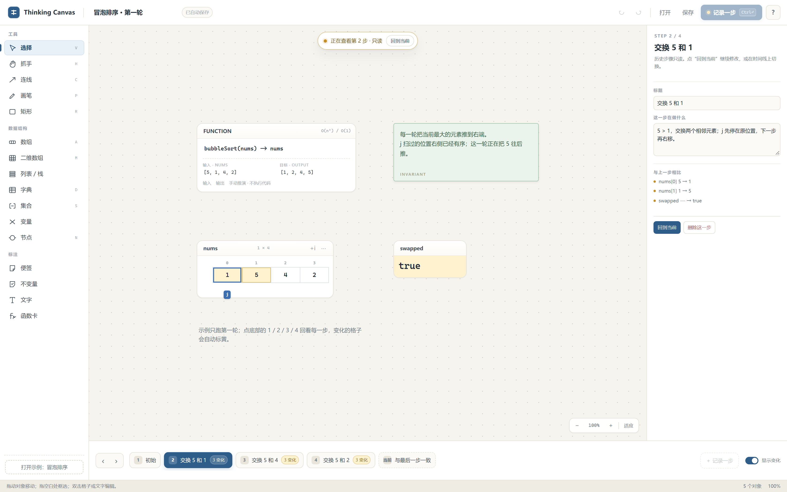

# Thinking Canvas · 算法思考画布

[项目主页](https://qi001007.github.io/thinking-canvas/) · [GitHub](https://github.com/qi001007/thinking-canvas) · [Releases](https://github.com/qi001007/thinking-canvas/releases/latest)

[](https://github.com/qi001007/thinking-canvas/actions/workflows/ci.yml)
[](LICENSE)
[](https://github.com/qi001007/thinking-canvas/releases)

在写代码之前，把算法摆在一张画布上想清楚：函数要什么输入输出、数据怎么变、指针走到哪、这一步和上一步差在哪。



> 它不执行代码，也不替你选算法。它只负责让你已经在纸上做的推演变快、变清楚、可回看。

## 为什么做这个

- **纸上推演**：数组、指针、交换、擦掉重画；步骤一多就找不到“上一步是什么”。
- **自动可视化工具**：擅长演示已知算法，但不适合设计自己的函数；布局也是它替你决定。
- **Thinking Canvas**：保留自由画布，同时把“函数、状态、步骤、差异、指针”做成可操作的积木。

## 功能

- **双栏管理**：画板独立成栏，工具与数据另成一栏；画板列表再长也不挤压工具区。
- **画板搜索**：按标题过滤；`Ctrl+K` 聚焦、`Esc` 清空、`Enter` 打开首个结果。
- **可调分栏**：画板栏、工具栏、检查器栏的边界可拖；宽度记住；双击分隔条复位；画板/工具可压成图标轨道。
- **数据卡片**：数组 / 二维数组、列表 / 栈、字典、集合、变量、节点、便签、函数卡。
- **步骤快照**：点“记录一步”保存当前状态；底部时间线前后翻看，历史步骤只读。
- **自动差异**：与上一步相比，变化的格子标黄、变量标黄、指针移动会提示。
- **指针**：`i` / `j` / `left` / `right` 拖到格子上就吸附；位置随步骤保存。
- **不变量**：绿色便签始终可见；函数卡写签名、输入、输出和复杂度目标。
- **自由标注**：连线、矩形、画笔、文字；支持缩放、平移、框选、多选、吸附参考线、撤销/重做。
- **画板管理**：画板栏新建、切换、删除；所有画板统一放在应用旁边的 `boards/` 文件夹，删除移到 `boards/.trash/`。
- **本地优先**：画板是普通 JSON，分栏宽度存在 `boards/.ui-state.json`；自动保存；Windows 桌面应用，不联网、不上传。
- **安静界面**：状态提示自动消失；滚动条细、统一色，鼠标进入对应栏才出现。

## 30 秒上手

1. 画板栏点 + 新建画板；点工具栏“数组”，双击格子输入 `2 7 11 15`。
2. 选中一个格子，右键“加指针”，或拖一个指针胶囊到格子上。
3. 按 `Ctrl+Enter` 记录一步；改几个值、移动指针，再记录一步。
4. 点底部时间线回看；变了的格子会自动标黄。点“回到当前”继续编辑。

选中格子时字母键用于输入；按 `Esc` 退出格子选择后，`V` / `H` / `A` / `D` 等单字母快捷键恢复。

## 快捷键

| 操作 | 快捷键 |
|---|---|
| 选择 / 抓手 / 连线 / 画笔 / 矩形 | `V` / `H` / `C` / `P` / `R` |
| 数组 / 二维数组 / 列表 / 字典 / 集合 / 节点 / 函数卡 | `A` / `M` / `L` / `D` / `S` / `N` / `F` |
| 记录一步 | `Ctrl+Enter` |
| 保存当前画板 / 新建画板 | `Ctrl+S` / `Ctrl+N` |
| 搜索画板 | `Ctrl+K` |
| 上一步 / 下一步 | `Ctrl+←` / `Ctrl+→` |
| 撤销 / 重做 | `Ctrl+Z` / `Ctrl+Y` |
| 复制 / 删除 | `Ctrl+D` / `Delete` |
| 缩放 / 适应画布 | `+` / `−` / `Ctrl+0` |
| 临时抓手 / 帮助 | `Space` / `?` |

## 下载与运行

### Windows 桌面版

从 [Releases](https://github.com/qi001007/thinking-canvas/releases/latest) 下载 `ThinkingCanvas.exe`，双击即可。需要 Microsoft Edge WebView2 Runtime；Windows 10/11 通常已预装。

### 从源码运行

```powershell
python -m pip install -r requirements.txt
python app\shell.py
```

也可以双击 `run.cmd`（源码）或 `start.cmd`（优先使用旁边的 `ThinkingCanvas.exe`）。

画板数据在应用旁边的 `boards/`，分栏宽度在其中的 `.ui-state.json`。源码运行就是仓库根目录，打包运行就是 exe 旁边。

### 构建 exe

PyInstaller 需要在构建环境里安装 `pywebview` 和 `pyinstaller`：

```powershell
python -m PyInstaller --noconfirm --clean --onefile --windowed --name ThinkingCanvas `
  --icon app/app.ico --add-data "web;web" app/shell.py
```

本机 Anaconda 环境还需要显式带上 OpenSSL / libffi DLL（PyInstaller 找不到时）：

```powershell
--add-binary "<Anaconda>/Library/bin/libcrypto-1_1-x64.dll;." `
--add-binary "<Anaconda>/Library/bin/libssl-1_1-x64.dll;." `
--add-binary "<Anaconda>/Library/bin/ffi.dll;."
```

`scripts/build_exe.py` 会自动查找当前 Python 前缀下的这些 DLL。

## 测试

```powershell
node --test tests/core.test.mjs tests/panes.test.mjs
python -m pytest tests/test_api.py -q
python app\shell.py --smoke
```

- Node 测试覆盖模型、快照、差异、序列化、几何、批量输入解析、分栏宽度与窄窗压缩。
- Python 测试覆盖画板新建/列出/保存/加载/删除、旧会话迁移、坏输入拒绝、UI 状态存取。
- `--smoke` 用真实 WebView2 启动，前端跑完断言后通过 Python API 回报；窗口版 exe 的结果写到 `%APPDATA%\ThinkingCanvas\smoke.json`（仅测试标记，不是画板数据）。

## 架构

```
app/            pywebview 桌面壳：窗口、原生对话框、原子写入
boards/         画板数据（运行时生成；README 说明格式，JSON 不提交）
web/
  index.html    单页界面
  css/          设计变量、布局、画布、控件
  js/core/      纯数据层：模型、步骤、差异、几何、持久化（无 DOM）
  js/ui/        渲染、交互、双栏与分隔条、时间线、检查器、快捷键
tests/          核心测试、分栏测试与文件 API 测试
docs/           需求、技术、决策、进度、反馈、编码原则、前端设计规范
site/           GitHub Pages 项目主页
```

核心层不碰 DOM，UI 层不自己维护第二份状态；快照只记录数据卡片和指针，画布布局和标注是持久对象。界面文案遵守 [前端设计规范](docs/前端设计规范.md)。详细设计见 [技术文档](docs/技术文档.md) 和 [决策记录](docs/决策.md)。

## 明确不做

- 不执行用户代码、不自动追踪 Python 变量、不读取内存。
- 不自动布局树/图，不预置算法模板。
- 不做账号、云同步、多人协作。
- 不收集遥测。

## 路线图

- 分支时间线：从任意一步复制出新尝试并并排比较。
- 伪代码面板：步骤绑定代码行，翻步骤时高亮对应行。
- 更多数据结构：链表/树/图的专用节点与自动布局（可选）。
- 导出 PNG / SVG、双语界面、更多示例。
- macOS / Linux 打包（pywebview 已跨平台，主要差 WebView 运行时和打包验证）。

## 致谢与许可

参考了 [trace-by-hand-whiteboard](https://github.com/pjwang2022/trace-by-hand-whiteboard) 作为组件广度和“画布 + 手动推演”方向的重要对照。该仓库当前没有许可证，本项目**没有复制它的代码**，是独立实现；功能取舍和交互设计由本项目自行完成。

MIT License，见 [LICENSE](LICENSE)。

---

### English summary

Thinking Canvas is a local Windows desktop canvas for **designing algorithms before coding**. Put arrays, matrices, maps, variables, nodes and notes on an infinite canvas; drag pointers onto cells; record snapshots; flip through the timeline; changed cells are highlighted automatically. It does not execute code, choose algorithms, or auto-layout your data. Projects are plain JSON; everything stays on your machine. Built with Python + pywebview and a framework-free JavaScript front end. MIT licensed.
